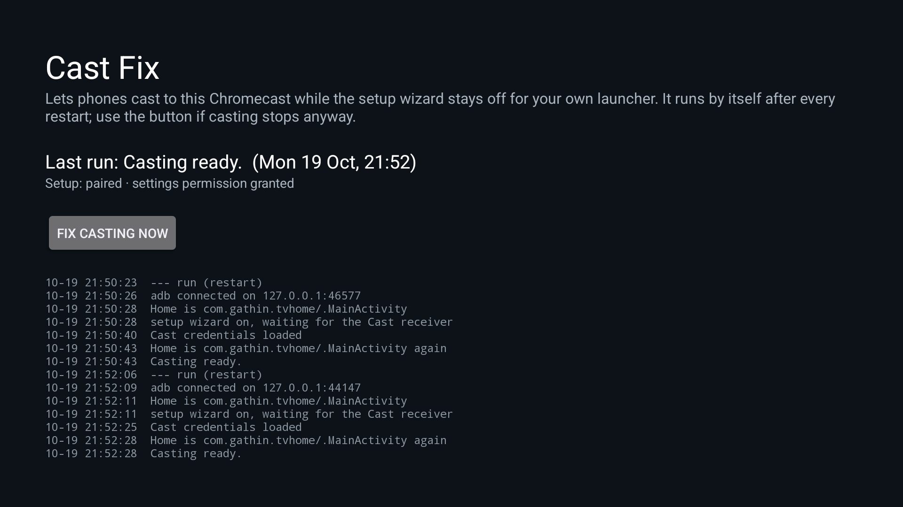

# Cast Fix

Keeps casting from phones working on a **Chromecast with Google TV** or **Google TV Streamer** whose setup
wizard is disabled so that a replacement launcher can own Home, as
[cleanyourtv](https://github.com/Gathin23/cleanyourtv)'s debloat lists do. It runs by itself after every
restart and whenever the Cast receiver loses its credentials without one, and needs no computer once it is
set up.

Tested on a Chromecast with Google TV HD (boreal), Google TV 14, build UTTC.250917.004. The 4K model
(sabrina) runs the same build and should behave the same, but hasn't been tried. Also tested on a Google TV
Streamer (kirkwood, Google TV 14, build UTTK.260317.003), including a reboot (the receiver came back without
its credentials and the boot run recovered them) and the 15-minute check with the receiver restarted under
it.



## The problem

With `com.google.android.tungsten.setupwraith` disabled, phones refuse to cast:

> Untrusted device. Living Room TV couldn't be verified. This could be caused by outdated device firmware.

The Cast receiver (`com.google.android.apps.mediashell`) gets its factory device credentials only from
the setup wizard, which hosts `CastInfoProvider`. Without it the receiver logs, once a minute,

```
E/ActivityThread: Failed to find provider info for com.google.android.tvsetup...castsetupinfo.CastInfoProvider
E/cast_ClientAuthCredsFactoryProvisioned: Cannot get device credentials
W/cast_shell: client_auth_signer.cc(180)] No private key, hence empty signature.
```

and answers the phone's authentication challenge unsigned. The wizard can't simply stay on either: its
`RecoveryActivity` claims Home at priority 1, above any third-party launcher, and adb may only disable
whole packages, not single components (`Shell cannot change component state`).

## The fix

Once the receiver has loaded the credentials it keeps them in memory until it restarts. It also restarts
by itself: on the HD it exited and came back almost every night, between 2 and 5 am, while the TV only
slept, and each time casting stopped until the next fix. So Cast Fix runs after every boot, and every 15
minutes it sends the receiver the same authentication challenge a phone does, over the local Cast port
(no adb needed for that). When the answer comes back unsigned, it:

1. switches Wireless debugging on and connects to the TV's own adbd over loopback, with a key that was
   paired once
2. puts back anything an interrupted earlier run left behind (see below)
3. asks the receiver whether it can already sign, with the same handshake a phone makes. If it can, there
   is nothing to do and the run ends there
4. otherwise switches the stock launcher on (so a Home press in the meantime lands somewhere safe), then
   the setup wizard
5. asks the receiver every 3 seconds whether it signs now (or, while it doesn't answer on its port, reads
   its log for `Created singleton instance of ClientAuthSigner`). It usually does within seconds.
6. if it still hasn't after 20 seconds, restarts the receiver (`am crash`) while the wizard is on. A
   receiver that has run for a while without its credentials can keep signing empty even after the wizard
   answers it; restarted, it signed within 6 seconds. One that signs is never restarted.
7. switches the wizard and the stock launcher off again, puts your launcher back as Home (or leaves the
   stock launcher on if that fails), and checks that the receiver still signs
8. switches Wireless debugging off again

Every change is recorded before it is made. If a run dies halfway (the app killed, adb stalling, the TV
going to sleep), the next start puts things back first: the setup wizard off, then Home. That start is the
next boot, the 15-minute check, or opening the app. On a Google TV Streamer this matters most, because
there a wizard left on makes system_server crash-loop about every 47 seconds.

A wizard someone else left on is switched off at the end of a run, but only on a TV set up with a
replacement launcher, and never while the wizard still owns the saved Wi-Fi network: Android deletes such a
network when the wizard is disabled, which takes a TV without Ethernet off Wi-Fi.

That is also why a signing receiver alone does not make a run say "Casting already works.": on the Streamer
a wizard left on with your own launcher owning Home is the state that crash-loops `system_server`, so the
run switches it off first. On a stock setup, where the wizard stays on and casts, the run leaves it alone.

A run at boot took about 20 seconds in testing, and a run after a receiver restart about 15. The **Cast
Fix** tile in the app list does the same by hand; when casting already works it only checks and says so.

The 15-minute check is a JobScheduler job, which Android would hold back for hours while the TV sleeps,
so the first run that reaches adb turns battery optimization off for the app (`dumpsys deviceidle
whitelist +com.thayford.castfix`). That also lets the check start the fix from the background.

### If a boot run loses to the network

A run started at boot can find Wi-Fi still coming up. If the first attempt still fails, one more attempt
runs a minute later. That covers the ordinary case where the radio associates late, without leaving the TV
without credentials until someone opens the app by hand. Installing an update also triggers a run, because
an update replaces the running process and would otherwise leave casting broken until the next restart.

## Two more fixes (1.2)

From 1.2 a small always-on service ("guard") also handles two problems the HD showed alongside casting.
Both can be switched off and are harmless where they don't apply.

**Player controls that never hide during a cast.** While an accessibility service such as
[Key Mapper](https://github.com/keymapperorg/KeyMapper) (used to remap the remote's YouTube button once
the stock launcher is off) is on, the Cast receiver's web player builds an accessibility tree, and Disney+'s
cast player then keeps its controls (subtitles, scrub bar) on screen after every episode change instead of
hiding them after a few seconds. With the service off they hide again. So while the Cast receiver's player
(`mediashell/...CastWebContentsActivity`) is in front, the guard switches off the enabled accessibility
services that aren't screen readers (spoken or braille feedback), and switches them back on 3 seconds
after the cast leaves the screen. Remapped buttons don't work during a cast; they're back as soon as you
leave it. It sees what's in front from usage events, polled once a second while the screen is on.

```sh
adb shell settings put global castfix_cast_a11y off       # never pause anything
adb shell settings put global castfix_cast_a11y io.github.sds100.keymapper/.system.accessibility.MyAccessibilityService   # only these (comma-separated)
adb shell settings delete global castfix_cast_a11y        # back to auto
```

**A Bluetooth remote that stops reconnecting.** An LE remote disconnects whenever it idles and reconnects on
the next key press, because the TV keeps listening for it: the LE connector is ARMED, with the remote on its
accept list. Two ways that listening stops for good, while the remote stays paired, until Bluetooth
restarts:

- the accept list left empty (`Shadow le accept list size:0`), documented on a Chromecast HD by
  [adn0liva/chromecast-hd-remote-fix](https://github.com/adn0liva/chromecast-hd-remote-fix), where it
  happened about 8 times a day
- the connector frozen in `DISARMED` or `DISARMING` (`le_connectability_state`), with the accept list
  intact, seen here twice, for 3 days and for 26 hours

Every 30 seconds, and right away when the screen comes on, the guard reads `dumpsys bluetooth_manager`.
If a paired LE input device is disconnected and either one shows, in two checks 15 seconds apart, it
restarts Bluetooth through adb (`cmd bluetooth_manager disable` / `enable`; apps targeting Android 13 or
later can no longer switch Bluetooth themselves), at most once every 3 minutes. That takes a second or two
and drops every Bluetooth device briefly, headphones included; the pairing stays. Classic (BR/EDR) devices
are ignored.

```sh
adb shell settings put global castfix_remote_watchdog 0   # off (delete the setting to turn it back on)
adb shell am broadcast -n com.thayford.castfix/.TestReceiver -a com.thayford.castfix.TEST_REMOTE_RESTART   # test the restart
```

The first adb run after installing 1.2 grants what these need (the guard starts one by itself once the app
is paired): `pm grant com.thayford.castfix android.permission.DUMP` to read the Bluetooth dump, and
`appops set com.thayford.castfix GET_USAGE_STATS allow` to see what's on screen.

## Install (once, from a computer with adb)

You need adb on a computer connected to the TV (Developer options > Wireless debugging > Pair device with
pairing code, `adb pair`, `adb connect`). Download `castfix-<version>.apk` from
[Releases](../../releases), or build it (below), then:

```sh
adb install castfix-1.3.apk
adb shell pm grant com.thayford.castfix android.permission.WRITE_SECURE_SETTINGS
adb shell dumpsys deviceidle whitelist +com.thayford.castfix    # the first run does this too
adb shell am start -n com.thayford.castfix/.MainActivity    # once, or Android never sends it boot events
```

If `adb install` hangs (Android 14 can wait for an on-screen confirmation), `adb push` the APK to
`/data/local/tmp/` and run `adb shell pm install -r /data/local/tmp/castfix-1.3.apk` instead. Updating
from 1.0, 1.1 or 1.2 the same way keeps the pairing, and the 15-minute check and the guard start without
opening the app.

Then pair the app itself. On the TV open Developer options > Wireless debugging > **Pair device with
pairing code**, and while that dialog is still open run, with the port and code it shows:

```sh
adb shell am broadcast -n com.thayford.castfix/.PairReceiver --ei port <pairing port> --es code <code>
# Broadcast completed: result=0, data="paired"
```

When the TV asks "Allow wireless debugging on this network?", tick **Always allow on this network**.
Allowed only once, Android asks again each time Cast Fix switches Wireless debugging on, and switches it
straight back off while nobody answers, so runs at boot fail. The permission belongs to the access point
(its BSSID): a mesh node, a repeater or the router's other band asks again.

The app's screen now reads "Setup: paired · settings permission granted · adb-only permissions granted"
(or "pending (next adb run)" until the first run has granted them). Leave Developer options on;
Wireless debugging itself can be off. Restart the TV and a "Cast Fix: Casting ready." message appears
within a minute.

## Security

- The app holds an adb key for your TV, so it can do anything `adb shell` can. The key stays in the app's
  private storage, and Wireless debugging is on only for the seconds a run takes.
- The pairing and test receivers require `android.permission.DUMP`, which the adb shell holds and ordinary
  apps don't (from 1.2 Cast Fix holds it too, to read the Bluetooth dump), so no other app on the TV can
  feed it a pairing code or make it restart Bluetooth.
- From 1.2 it can see which app is in front (usage access) and switches accessibility services off and on
  during casts. It only ever restores the ones it switched off, also after a crash or restart.
- It sets `adb_allowed_connection_time` to 0 (the "Disable adb authorization timeout" developer option),
  because a paired key otherwise lapses after 7 days without a connection and restarts can be further
  apart than that. This applies to every paired key, including your computer's.
- No network use beyond adb over loopback, an mDNS lookup of the TV's own debugging port, and the Cast
  authentication challenge to `127.0.0.1:8009`, which is read-only and only asks whether the reply carries
  a signature. No analytics, no internet access.

## Uninstall

```sh
adb uninstall com.thayford.castfix
adb shell settings delete global adb_allowed_connection_time     # back to the 7-day default
```

and remove "CastFix" under Wireless debugging > Paired devices. Casting then stops working again after the
next restart, unless you re-enable the setup wizard (and with it the stock launcher).

## Troubleshooting

The screen shows the last result and the last lines of the log; everything also goes to logcat with tag
`CastFix`. To keep Wireless debugging on after a run so the log can be read from a computer:

```sh
adb shell settings put global castfix_keep_debugging 1     # settings delete global castfix_keep_debugging to undo
```

"Wireless debugging would not stay on: allow it on this network for good" means Android kept switching
it off again: see "Always allow on this network" under Install.

Every adb command has a 20-second limit and is retried up to three times on a fresh connection.
libadb's `open()` waits for adbd's OKAY without a timeout and can miss it when the answer arrives before
the wait starts; that hung a run once just after a cold boot.

One thing to know when reading the logs by hand: the receiver's state is **not decided from the log** while
it answers on its port. It is decided by making the device-auth handshake a phone makes, against the TV's
own port 8009 on loopback. The log is read only when the receiver does not answer there at all, which is
why a load line can be missing while casting works perfectly.

## Build

JDK 17 and Android SDK platform 34:

```sh
./gradlew testReleaseUnitTest assembleRelease     # app/build/outputs/apk/release/app-release.apk
```

The unit tests cover the logic that needs no TV: Home classification, shell exit codes and the remote
watchdog's reading of the Bluetooth dump. GitHub Actions runs them and the build on every push and pull
request.

## Credits

- Contributors to 1.3, from their pull requests:
  - [Sebastián Valdivia Loyola](https://github.com/svaldivia12) (#1): Google TV Streamer (kirkwood)
    support, the recovery of interrupted runs, Home read from the resolver, exit codes for `pm`, the log
    filter fix, safe log writes, the unit tests and the CI workflow
  - [lukasmeggle](https://github.com/lukasmeggle) (#2, #3): restarting the receiver when the wizard alone
    doesn't bring its credentials back, and noticing when Wireless debugging won't stay on
- [adn0liva/chromecast-hd-remote-fix](https://github.com/adn0liva/chromecast-hd-remote-fix) documented the
  empty-accept-list remote fault the watchdog also checks for.

- [libadb-android](https://github.com/MuntashirAkon/libadb-android) by Muntashir Al-Islam (used under
  Apache-2.0), [Conscrypt](https://github.com/google/conscrypt) (Apache-2.0) and
  [Bouncy Castle](https://www.bouncycastle.org/) (MIT-style licence).
- Pairing an app with its own TV's Wireless debugging comes from
  [adb-auto-enable](https://github.com/mouldybread/adb-auto-enable).
- The cast icon is the Material Icons "cast" glyph (Apache-2.0).

Cast Fix is MIT-licensed; see [LICENSE](LICENSE).
