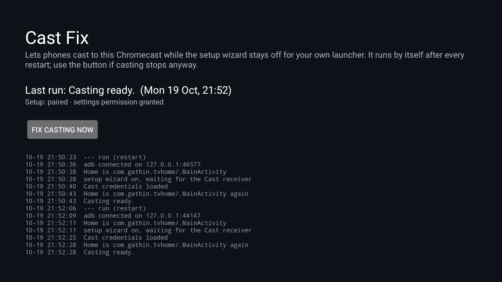

# Cast Fix

Keeps casting from phones working on a **Chromecast with Google TV** whose setup wizard is disabled so
that a replacement launcher can own Home, as [cleanyourtv](https://github.com/Gathin23/cleanyourtv)'s
debloat lists do. It runs by itself after every restart and needs no computer once it is set up.

Tested on a Chromecast with Google TV HD (boreal), Google TV 14, build UTTC.250917.004, and on a
Google TV Streamer (kirkwood), Google TV 14, build UTTK.260317.003. The 4K model (sabrina) runs the
same build as boreal and should behave the same, but hasn't been tried.

On the Streamer, leaving the setup wizard enabled is not a neutral state: its `RecoveryActivity`
claims Home, and `system_server` then crash-loops inside `Task.moveToBack` roughly every 47 seconds,
taking the wizard and SystemUI down with it. Cast Fix therefore enables the wizard for the shortest
window it can and switches it back off on every exit path, including when a run is killed (see
[If a run is interrupted](#if-a-run-is-interrupted)).



## The problem

With `com.google.android.tungsten.setupwraith` disabled, phones refuse to cast:

> Untrusted device. Living Room TV couldn't be verified. This could be caused by outdated device firmware.

The Cast receiver (`com.google.android.apps.mediashell`) gets its factory device credentials only from
the setup wizard, which hosts `CastInfoProvider`. Without it the receiver logs, once a minute,

```
E/ActivityThread: Failed to find provider info for com.google.android.tvsetup...castsetupinfo.CastInfoProvider
E/cast_ClientAuthCredsFactoryProvisioned: Cannot get device credentials
W/cast_shell: client_auth_signer.cc(180)] No private key, hence empty signature.
```

and answers the phone's authentication challenge unsigned. The wizard can't simply stay on either: its
`RecoveryActivity` claims Home at priority 1, above any third-party launcher, and adb may only disable
whole packages, not single components (`Shell cannot change component state`).

## The fix

Once the receiver has loaded the credentials it keeps them in memory until it restarts. So after every
boot Cast Fix:

1. switches Wireless debugging on and connects to the TV's own adbd over loopback, with a key that was
   paired once
2. puts back anything an interrupted earlier run left behind (see below)
3. checks whether the receiver holds its credentials by asking it, on `127.0.0.1:8009`, to sign the
   device-auth challenge phones send: an empty signature means they are missing. Only a receiver that does
   not answer there is judged by watching what it logs for up to two of its one-minute retries
4. switches the stock launcher on (so a Home press in the meantime lands somewhere safe), then the setup
   wizard
5. waits until the receiver signs (or, if it does not answer on 8009, logs `Created singleton instance of
   ClientAuthSigner`), which took 7 to 14 seconds in testing, and switches the wizard off as soon as it does
6. switches the stock launcher off again and puts your launcher back as Home, or leaves the stock
   launcher on if that fails
7. switches Wireless debugging off again

A run at boot took about 20 seconds in testing. The **Cast Fix** tile in the app list does the same by hand, in
case casting stops without a restart; when casting already works it only checks and says so.

If the setup wizard is already enabled when a run starts, that is treated as work to finish rather than
as "already fine": the credentials are checked, and the wizard is switched back off.

### If a run is interrupted

A run records what it is about to change *before* it changes anything, and clears that record when it
finishes. If the TV sleeps, adb stalls past its retries, or Android kills the app mid-run, the next run —
after a restart, from the button, or just by opening the app — finds the record and puts the device back
first: the setup wizard off, the stock launcher back as it was, and Home returned to your launcher. Until
that happens the app's screen says the last run did not finish.

## Install (once, from a computer with adb)

You need adb on a computer connected to the TV (Developer options > Wireless debugging > Pair device with
pairing code, `adb pair`, `adb connect`). Download `castfix-<version>.apk` from
[Releases](../../releases), or build it (below), then:

```sh
adb install castfix-1.0.apk
adb shell pm grant com.thayford.castfix android.permission.WRITE_SECURE_SETTINGS
adb shell am start -n com.thayford.castfix/.MainActivity    # once, or Android never sends it boot events
```

If `adb install` hangs (Android 14 can wait for an on-screen confirmation), `adb push` the APK to
`/data/local/tmp/` and run `adb shell pm install -r /data/local/tmp/castfix-1.0.apk` instead.

Then pair the app itself. On the TV open Developer options > Wireless debugging > **Pair device with
pairing code**, and while that dialog is still open run, with the port and code it shows:

```sh
adb shell am broadcast -n com.thayford.castfix/.PairReceiver --ei port <pairing port> --es code <code>
# Broadcast completed: result=0, data="paired"
```

The app's screen now reads "Setup: paired · settings permission granted". Leave Developer options on;
Wireless debugging itself can be off. Restart the TV and a "Cast Fix: Casting ready." message appears
within a minute.

## Security

- The app holds an adb key for your TV, so it can do anything `adb shell` can. The key stays in the app's
  private storage, and Wireless debugging is on only for the seconds a run takes.
- The pairing receiver requires `android.permission.DUMP`, which the adb shell holds and ordinary apps
  don't, so no other app on the TV can feed it a pairing code. Any app granted DUMP could, so it is a
  gate rather than a guarantee.
- It sets `adb_allowed_connection_time` to 0 (the "Disable adb authorization timeout" developer option),
  because a paired key otherwise lapses after 7 days without a connection and restarts can be further
  apart than that. This applies to every paired key, including your computer's. It is only set when it
  is not already 0, so uninstalling can put the default back.
- No network use beyond adb over loopback and an mDNS lookup of the TV's own debugging port. No
  analytics, no internet access.

## Uninstall

```sh
adb uninstall com.thayford.castfix
adb shell settings delete global adb_allowed_connection_time     # back to the 7-day default
```

and remove "CastFix" under Wireless debugging > Paired devices. Casting then stops working again after the
next restart, unless you re-enable the setup wizard (and with it the stock launcher).

## Keeping the receiver awake

Android 14's cached-app freezer can stop the Cast receiver when nothing on the TV has it bound, and then
phones stop discovering the TV. The documented fix is for a **Home app** to bind `/.CastReceiverService`
with `BIND_AUTO_CREATE`; on a Google TV Streamer the receiver is normally bound by an installed casting app
(Netflix, Spotify) and stays `vis (service)` with `isFrozen=false`.

Cast Fix deliberately does not do this. It is a repair tool that runs for about twenty seconds and exits;
holding a permanent binding would make it a background service in all but name, keep the receiver alive
against the owner's wishes, and stop working the moment Cast Fix is uninstalled. The binding belongs to the
launcher, which already owns process lifetime and can bind at boot without a foreground service.

To check whether it is a problem on your TV:

```sh
adb shell dumpsys activity processes | grep -A60 mediashell | grep -E "isFrozen|curProcState"
adb shell dumpsys activity oom | grep -A2 mediashell
```

`isFrozen=false` and `vis (service)` mean the receiver is already being kept awake by something.


## Troubleshooting

The screen shows the last result and the last lines of the log; everything also goes to logcat with tag
`CastFix`. To keep Wireless debugging on after a run so the log can be read from a computer:

```sh
adb shell settings put global castfix_keep_debugging 1     # settings delete global castfix_keep_debugging to undo
```

Every adb command has a 20-second limit and is retried up to three times on a fresh connection.
libadb's `open()` waits for adbd's OKAY without a timeout and can miss it when the answer arrives before
the wait starts; that hung a run once just after a cold boot.

Two things to know when reading the logs by hand:

- The receiver's state is decided from a **window**, not from a snapshot. The main log buffer on a Google
  TV Streamer is 256 KiB and the Cast receiver alone fills it in well under an hour, so "no failure line in
  the buffer" means nothing. Cast Fix watches for two of the receiver's one-minute retries and only calls
  a silent receiver healthy when it has watched a full window.
- Timestamps are read as epoch seconds (`logcat -v epoch`), so the check survives midnight, a timezone
  change, and the clock stepping when NTP syncs after boot. The `MM-DD hh:mm:ss` form is ambiguous across
  midnight and moves backwards when the clock does.

A third, learned the hard way on the Streamer:

- The line that proves success, `Created singleton instance of ClientAuthSigner`, is logged by the native
  shell under the tag **`cast_shell`**, not by `cast_ClientAuthCredsFactoryProvisioned`. Filtering by tag
  misses it entirely and reports "did not load" while the receiver is in fact signing correctly. Cast Fix
  filters by message text and also treats the retries stopping as success, because a receiver that had
  already loaded and been restarted does not log the signer again.

## Build

JDK 17 and Android SDK platform 34. `local.properties` is not committed; create it with the SDK path:

```sh
echo "sdk.dir=$HOME/Android/Sdk" > local.properties
JAVA_HOME=/usr/lib/jvm/java-17-openjdk ./gradlew assembleRelease   # app/build/outputs/apk/release/app-release.apk
JAVA_HOME=/usr/lib/jvm/java-17-openjdk ./gradlew testReleaseUnitTest
```

The JDK 17 is required: AGP 8.5.2 does not support newer JDKs, and a system default of 21 or later fails.

## Credits

- [libadb-android](https://github.com/MuntashirAkon/libadb-android) by Muntashir Al-Islam (used under
  Apache-2.0), [Conscrypt](https://github.com/google/conscrypt) (Apache-2.0) and
  [Bouncy Castle](https://www.bouncycastle.org/) (MIT-style licence).
- Pairing an app with its own TV's Wireless debugging comes from
  [adb-auto-enable](https://github.com/mouldybread/adb-auto-enable).
- The cast icon is the Material Icons "cast" glyph (Apache-2.0).

Cast Fix is MIT-licensed; see [LICENSE](LICENSE).
